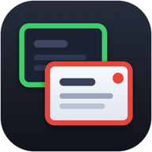

# CueDeck

**Every speaker's slides from one seat: preview, TAKE, timers, prompter, streaming.**

Free · macOS & Windows · for live events and conferences

[**Download**](https://github.com/ttpa3dhuk/CueDeck/releases/latest) ·
[Русская версия](README.ru.md) ·
[What's new](CHANGELOG.md) ·
[Video](https://www.youtube.com/watch?v=Vi5BDG_WoRg)


Line up every speaker beforehand: PDF, PowerPoint, Keynote, video, a guest laptop. Stage the next one in Preview and press TAKE. It goes to the hall, their timer is loaded, the prompter follows.

Group several materials for one speaker into a folder and collapse it. Cmd/Ctrl selects cards; right-click → Group creates a folder. Each material keeps its timer and comment, and the grouping is saved with the project.

## Three screens, one operator


## A prompter speakers actually read

Current and next slide, your notes in real time, a timer that turns yellow and red. Or give the whole screen to the timer and feed it to a stage monitor.

| | |
|---|---|
|  |  |

Drag the timer and messages wherever you want them:


## Stream without OBS

The STREAM button sends the hall picture and sound to YouTube, VK and Telegram, up to 5 destinations at once. You can add or drop one while live. Stats show whether a problem is your computer, the network or the platform.


## Window capture and OMT input

Click + → Window… in the speaker list to capture PowerPoint, Zoom or another application. Add it to the playlist, stage it in Preview and press TAKE. PowerPoint keeps its animations and transitions because the presentation still runs in PowerPoint. Control it in the original application.

The capture editor has a live preview, crop controls in pixels and a frame rate selector. Changes reach the hall when you save them. Window audio and notes from a running PowerPoint presentation are not connected yet.

Click + → OMT… to receive a network source, for example from vMix on another computer. Choose a discovered source or enter its address. CueDeck waits for a lost source to return. Use gigabit Ethernet for video.

OMT audio pitch can change after switching sound off and back on; we are still fixing it. For picture only, uncheck audio when adding the source. Other GPUs and long sessions with the new Windows frame transport still need testing. Transparent input uses the previous frame transport.

## OMT outputs for vMix and OBS

The timer on a transparent background, the hall (with sound) and the prompter go out as network sources over [OMT](https://github.com/openmediatransport), the open alternative to NDI. vMix 29+ sees them natively, OBS needs the OMT plugin. The timer lands on top of your picture with no keying. When vMix takes a CueDeck source to program, the OMT button turns red.

Set it up in Settings → OMT outputs (name, 720p / 1080p / 4K, 15–60 fps). Use a wired network for video: each receiver gets its own stream, about 60 Mbit/s at 1080p30. Over Wi-Fi we got 11 frames out of 30.

We haven't tested live vMix 29 yet, only OBS. If something goes wrong in vMix, [open an issue](https://github.com/ttpa3dhuk/CueDeck/issues/new/choose).

## Stream Deck and Companion

A ready-made [Bitfocus Companion](https://bitfocus.io/companion) page: live timer, TAKE with the speaker's name, and an OMT lamp that turns red when vMix takes us on air. Two more pages have a button for every CueDeck command, so you can copy them and lay out your own deck. HTTP and OSC are there too ([setup](companion/README.md)).


## Download

| Computer | File from [the latest release](https://github.com/ttpa3dhuk/CueDeck/releases/latest) |
|---|---|
| Mac with Apple Silicon (M1 and later) | `CueDeck-<version>-Silicon-mac.zip` |
| Mac with Intel | `CueDeck-<version>-Intel-mac.zip` |
| Windows 10 / 11, installer | `CueDeck-<version>-Setup.exe` |
| Windows 10 / 11, Portable (no installation) | `CueDeck-<version>-win.zip` |

### First launch: the app isn't signed

On macOS: unzip, drag `CueDeck.app` to Applications, then right-click, "Open", and "Open" again. If macOS says the app is damaged: `xattr -cr /Applications/CueDeck.app`.

On Windows: unzip and run `CueDeck.exe`. SmartScreen will warn: click "More info", then "Run anyway". Still won't start? See [Windows: step by step](docs/windows.md).

PowerPoint and Keynote files need [LibreOffice](https://www.libreoffice.org/download/download-libreoffice/). PDF, images and video work without it.

[](https://www.youtube.com/watch?v=Vi5BDG_WoRg)

Full walkthrough, 40 min (in Russian)

## More

### All features

- Preview and Program, TAKE on `Tab`. Global clicker: PgUp/PgDn work even when CueDeck isn't focused
- Speaker playlist: drag-and-drop, a name and a timer per speaker
- Timer: countdown, stopwatch or clock. Presets and ±1 min on the fly, tick and gong sounds
- Notes reach the prompter in real time, PowerPoint speaker notes come in automatically
- Message to the speaker: "Wrap up", "Closer to the mic" or your own text
- Blackout / key visual (`B`): a still or looping video in the hall while you change files
- PowerPoint, Keynote, ODP: embedded videos and on-click animations play
- Videos synced across windows, per-clip loop, hold on first frame
- Photo and video lists as one playlist row, loop or shuffle with crossfade
- Live input: a guest laptop through a USB HDMI capture card joins the playlist like any file
- Audio: separate outputs for the hall and headphone cue/solo, level meters
- Streaming: RTMP/RTMPS, up to 5 destinations, a log file for every broadcast
- Stream Deck, Companion, OSC, HTTP, MIDI controllers
- Venue profiles: every setting for a known venue in one pick
- Projects move between computers, missing files are flagged when you open the project, not on air
- Quit confirmation mid-show. Help → Report a problem saves a zip with logs
- English and Russian interface

### Formats and devices

| What | Works | Note |
|---|---|---|
| PDF, PNG, JPG, WebP, GIF, BMP | yes | opens instantly |
| PPTX, PPT, ODP, Keynote | yes | converted once via LibreOffice, then cached. Exit effects and transitions don't play |
| Video H.264 + AAC (MP4, MOV, M4V), WebM | yes | MP4 (H.264 + AAC) is the safest |
| HEVC / H.265 | partly | usually fine on Mac, Windows needs HEVC Video Extensions |
| ProRes, DNxHD | no | transcode with [HandBrake](https://handbrake.fr/) |
| USB capture (UVC): Elgato Cam Link, AVMatrix, ATEM Mini, webcams | yes | if Photo Booth / Camera sees it, CueDeck will |
| Blackmagic DeckLink / UltraStudio | no | own driver, not visible as a camera |

### Keyboard

Remap in Settings → Keyboard shortcuts.

| Key | Action |
|---|---|
| `Tab` | TAKE: send preview to the hall |
| `←` `→` / `Space` / `PgUp` `PgDn` | Program: previous / next slide |
| `[` `]` | Preview: previous / next slide |
| `B` | Blackout / key visual |
| `T` / `R` | Timer start-pause / reset |
| `Cmd+,` | Settings |

### Build from source

```bash
git clone https://github.com/ttpa3dhuk/CueDeck.git
cd CueDeck
npm install
npm run dev           # development mode
npm test              # tests
npm run package:mac   # Mac zips (Apple Silicon + Intel)
npm run package:win   # Windows zip
```

Electron + TypeScript.

Found a bug? [Open an issue](https://github.com/ttpa3dhuk/CueDeck/issues/new/choose) or write to the support bot [@CueDeckSupport_Bot](https://t.me/CueDeckSupport_Bot) in Telegram. Help → Report a problem saves a zip with logs you can attach.

CueDeck is free and built in spare time. If it saved your show, you can [buy me a coffee](https://pay.cloudtips.ru/p/b79fa042).

[MIT](LICENSE) © 2026 [Azat Khusaenov](https://github.com/ttpa3dhuk)
