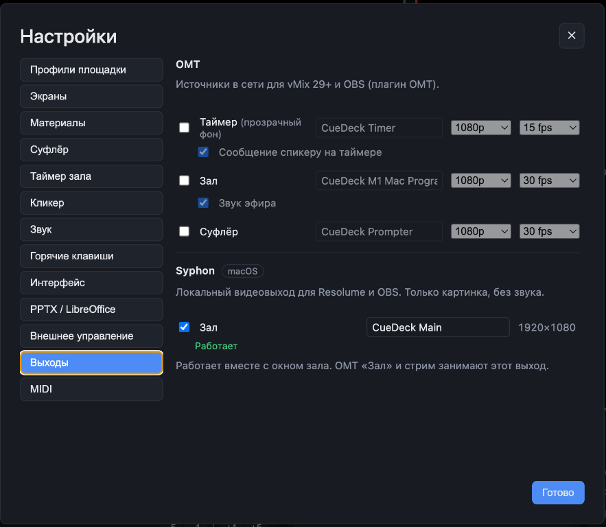
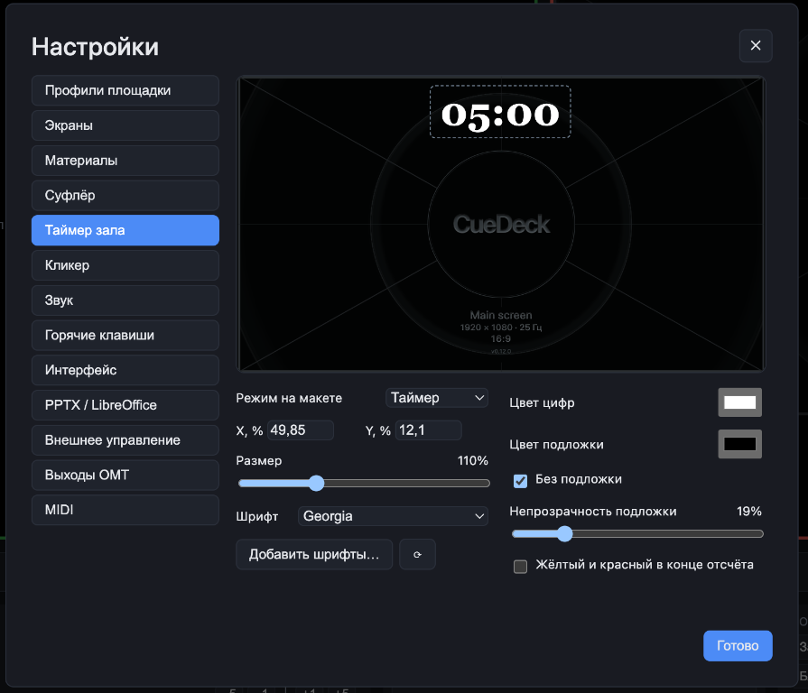
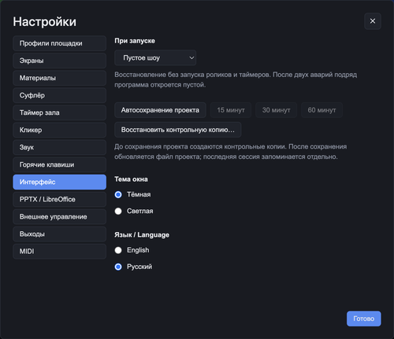
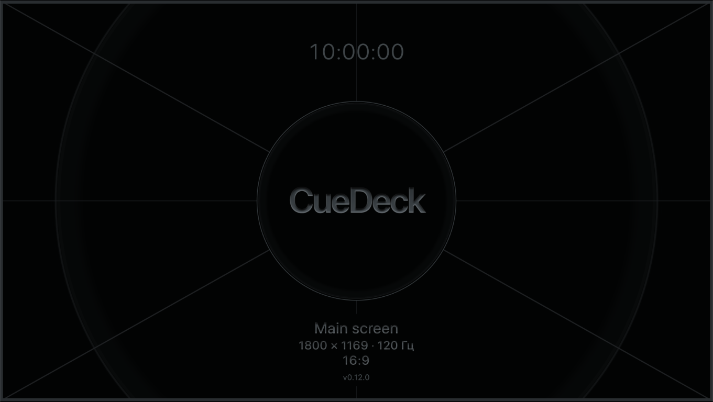
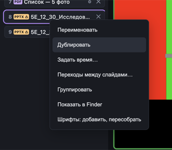
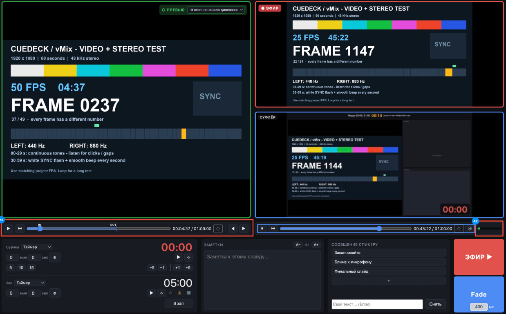
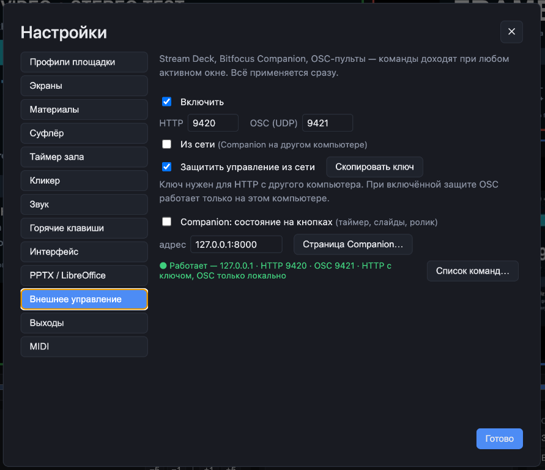
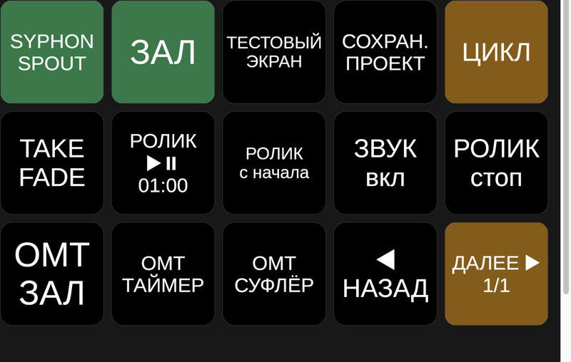
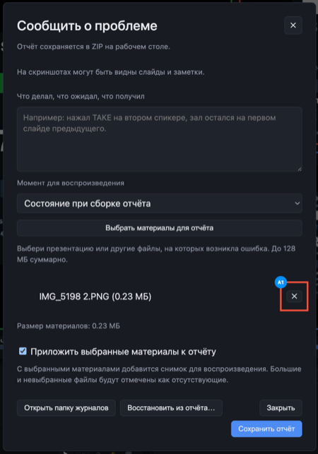

# CueDeck 0.13.0: Обновление Ядра, Syphon/Spout, экраны, таймеры, быстрые настройки, автосохранение

 ## Обновленное ядро Совместимость

Приложение переведено на Electron 44.7.2. Необходимость для корректной работы Syphon/Spout.

Для новой сборки нужна macOS 13 Ventura или новее; на Windows минимум остаётся Windows 10, сборка x64. 

Точные технические минимальные требования еще пока собираются и скоро добавяться в спек.

## Syphon/Spout 

Картинку зала можно передать в другое приложение на том же компьютере через Syphon на Mac или Spout на Windows. 
Включение и имя источника находятся в «Настройки → Выходы».

Например: Resolume нативная поддержка, OBS необходим плагин для приема Syphon/Spout.

Звук через Syphon/Spout не передаётся.

OMT «Зал» и встроенная трансляция имеют приоритет и останавливают Syphon/Spout-выход.

## Добавление файлов в плейлист

Файлы можно добавлять в CueDeck из папок в любое место в плейлисте переносом.

Двойной клик по карточке по умолчанию открывает теперь превью. Вывод в эфир двойным кликом можно отдельно включить в настройках кликера. 

У строки плейлиста обычный курсор, по отзывам смена курсора отвлекает от работы.

## Таймер зала и суфлера

У таймера зала и таймера суфлёра теперь можно выбрать шрифт, установленный на компьютере. Реализован удобный перебор шрифтов стрелками вверх-вниз без всплывающего окна.

Переработал настройки таймера зала: увеличил просмотр на всю ширину правой части окна. Положение, размер, шрифт, цвет и подложка находятся под ним.

У таймера зала появились назначаемые горячие клавиши старта, остановки и сброса. 
Для назначения перейдите в настройки горячих клавиш.

Теперь окно настроек можно двигать=)

## Экраны и звук в верхнем меню

Теперь настройки экрана и звука выведены отдельно в меню приложения 

В меню «Экраны» можно выбрать режим работы, назначить подключённые дисплеи оператору, залу и суфлёру, включить тестовый экран и монитор под эфиром. Там же находятся «Аудитория в окне» и переход сразу в настройки экранов.

Кнопка «Зал вкл / Зал выкл» рядом с Blackout скрывает и возвращает окно.

Если закрыть оконный зал крестиком в режиме "Аудитория в Окне", появиться предупреждение и подсказка как вернуть окно.

В меню «Звук» отдельно выбираются устройства эфира и предпрослушки.

## Монитор выхода и индикатор звука

Окно суфлера под эфиром теперь обновляется до 5 кадров в секунду. 
Индикатор звука перенесён в строку управления воспроизведением, чтобы не перекрывать картинку.

## Запуск, последняя сессия, автосохранение

В «Настройки → Интерфейс» можно выбрать пустое шоу или восстановление последней сессии при запуске.

После аварии CueDeck попробует восстановить последнюю сессию. Если программа завершится аварийно два раза подряд, следующий запуск откроет пустое шоу. Кнопка «Последний» останется доступной.

Там же можно включить автосохранение каждые 15, 30 или 60 минут. Пока проект не сохранён в файл, CueDeck создаёт контрольные копии. После сохранения автосохранение обновляет выбранный файл. Контрольную копию можно выбрать в настройках интерфейса.

## Тестовый экран для проверки выхода

Появился Test Screen

Автоматический показ можно отключить в «Настройки → Экраны → Тестовый экран»: галочка «Показывать автоматически при пустом шоу».

Наверху показывается системное время а внизу показывает название вывода, разрешение и частоту обновление экрана который назначен.

## Дублирование материалов

Правая кнопка по карточке → «Дублировать». Копия появляется сразу после оригинала, в той же папке и с теми же настройками. У неё своя запись в плейлисте, исходный файл на диске остаётся общим. 

## Начало и конец видеоролика: In/Out

У отдельных видеороликов в плейлисте можно задать начало и конец, воспроизводить или зацикливать только выбранный фрагмент. Границы сохраняются в проекте, исходный видеофайл не меняется.

I ставит начало, O ставит конец. Эти же команды и сброс доступны по правому клику на шкале времени. Стрелки влево-вправо при активном плеере двигают позицию по кадрам. Время отображается как минуты:секунды:кадры.

Alt/Option+I убирает In, Alt/Option+O убирает Out, сохраняя вторую границу. Команды ставят метки по текущей позиции ползунка; место правого клика её не меняет.

Изменённые границы сразу применяются к ролику в эфире. Для AV1 точный покадровый шаг и кадровый номер пока недоступны.

## Управление из сети по ключу

В настройках внешнего управления появилась необязательная защита по ключу. С ней для HTTP-команд и получения состояния с другого компьютера нужен ключ доступа.

В обновлённом модуле Companion ключ задаётся в подключении. Для Generic HTTP можно передать его в заголовке или адресе команды. При выключенной защите прежние подключения продолжают работать.

При включённой защите OSC работает только на том же компьютере. Если используете OSC по сети, учитывайте это перед включением галочки.

## Companion 0.4.1

В модуле Companion появились кнопки Syphon/Spout, включения и выключения окна зала, тестового экрана и сохранения проекта. Для выходов есть отдельные команды включения, выключения и переключения. Состояние выходов видно на кнопках. Добавлены управление тремя выходами OMT, TAKE с Fade, длительность Fade и выбор поведения ролика или слайдов при выдаче. Кнопка цикла ролика остаётся в разделе «Ролик в эфире».

Кнопка сохранения обновляет уже сохранённый проект. Первый раз нужно сохранить его в самом CueDeck и выбрать имя файла, потому что с деки диалог выбора файла не заполнить.

Для обновления откройте Modules → Import в Companion и импортируйте файл модуля `.tgz` из этого выпуска. Затем в подключении CueDeck выберите Module Version 0.4.1. Старые страницы сами не обновятся: новые кнопки нужно добавить из пресетов или импортировать обновлённую библиотеку страниц.

## Проверка файлов внутри PowerPoint

Добавил проверку имён встроенных медиафайлов PPTX перед извлечением в кэш. Файл с некорректным путём не должен записываться за пределами своей папки.

## Материалы в отчёте о проблеме

В окне отчёта сокращены пояснения. Выбранные файлы автоматически отмечаются для приложения, случайное вложение можно удалить отдельным крестиком. Размеры показаны в МБ, общий лимит 128 МБ.

## Видео на Windows и смена PowerPoint

Исправлена повторная установка позиции, пока предыдущая перемотка ещё не закончилась. После смены PowerPoint суфлёр подхватывает встроенный ролик новой презентации: старый номер слайда больше не мешает его загрузке.

На Windows добавлен автоматический режим для тяжёлого видео. Если декодеры долго не успевают, оператор и суфлёр получают готовые кадры зала.

Если в MOV декодируется только звук, а видеокодек не поддерживается, CueDeck показывает ошибку вместо пустого экрана со звуком.

## Наплыв при TAKE

Исправлены рывки при TAKE с Fade на Windows: они могли появляться даже на обычном H.264 1080p, который без перехода шёл плавно. Уходящее видео продолжает двигаться во время наплыва. 

Максимальная длительность Fade теперь 400 мс. Ограничил до полного исправление рывков на более высоких значениях Fade

## Над чем хочу работать дальше

В планах массовая подготовка презентаций без прокликивания каждой карточки, обновление изменённого PPTX без удаления записи, NDI и синхронное листание двух CueDeck по OSC.

Это направления следующих выпусков, пока без обещания дат и окончательного состава. Для проверки PowerPoint пригодятся сложные презентации со встроенным видео, звуком и анимациями, которые можно передать для теста вместе с примером правильного показа.

## Что пока остаётся

На Shuttle при живом просмотре тяжёлого H.264 4K/60 замечено короткое зелёное промаргивание, после которого ролик продолжился. Повторная диагностика его пока не поймала. Причина и исправление остаются открытыми.

4K всё ещё зависит от кодека, битрейта и компьютера. На слабой машине тяжёлый файл может идти с остановками, особенно в первые секунды до срабатывания автоматического режима. HDR и файлы с неизвестным цветовым пространством остаются на штатном пути. Материалы нужно проверять до мероприятия; гарантировать любое 4K-видео пока нельзя.

Когда на Windows включается передача готовых кадров зала для тяжёлого видео, при Fade оператор и суфлёр используют неподвижный уходящий кадр. Зал продолжает воспроизводить уходящий ролик. Частота отдельного монитора под эфиром остаётся 5 кадров в секунду.

## Если что-то пошло не так

Help / «Справка» → «Сообщить о проблеме…». CueDeck сохранит ZIP на рабочем столе, его можно прислать в [@CueDeckSupport_Bot](https://t.me/CueDeckSupport_Bot). Cmd/Ctrl+Shift+M отмечает момент сбоя в журнале.

